# 🎬 MiniMax-H3 (Hailuo AI) · Google Colab 视音频生成与分镜续写全流程管线

[](https://colab.research.google.com/github/spurbro/minimax-h3-colab-pipeline/blob/main/notebooks/MiniMax_H3_T4_GGUF_PlanB_Pipeline.ipynb)
[](https://colab.research.google.com/github/spurbro/minimax-h3-colab-pipeline/blob/main/notebooks/MiniMax_H3_A100_ComfyUI_Drive.ipynb)

本仓库提供 **MiniMax-H3（海螺 AI 音画同源多模态视频生成大模型）** 在 **Google Colab** 上的完整工程化部署与长视频分镜生成管线。同时覆盖 **免费层/低显存 Tesla T4 (15GB VRAM + 12.67GB RAM)** 与 **高性能 A100 (40GB/80GB VRAM + ComfyUI WebUI)** 两大工作流。

---

## 🌟 核心亮点与技术突破

### 1. 突破 Colab T4 12.67GB 内存墙（3-Part Zero-Copy `mmap` 内核补丁）
MiniMax-H3 包含 `8.06 GB` DiT 主干、`13.10 GB` Qwen3-VL-32B 多模态编码器及 `5.82 GB` 视音频双 VAE（合计 **26.98 GB**）。
在原生 `stable-diffusion.cpp` 中，`ModelManager::can_mmap_storage` 禁止了辅助模型文件（`source_file != 0`，即 13.1GB 的 Qwen3-VL）和 CPU 卸载模式使用 `mmap`，导致在 12.67GB 内存的 Colab T4 容器中必然触发 Linux OOM 崩溃（`returncode -9`）。

本项目通过 [`patches/apply_sdcpp_t4_mmap_patch.py`](./patches/apply_sdcpp_t4_mmap_patch.py) 对 `src/model_manager.cpp` 注入三处核心修补：
- 解除 `source_file != 0` 与 `residency_mode != ParamBackend` 的 `mmap` 封锁；
- 在 `mmap_params` 映射成功后标记 `state->loaded_to_params_backend = true`；
- 在 `load_tensors_to_params_backend` 中过滤已映射张量，彻底跳过堆内存分配与重复拷贝，使 **T4 运行期间系统内存占用稳定控制在 ~4.4 GB 以内**。

### 2. 方案 B：真实扩散多分镜链式续写（T2V $\to$ 尾帧提取 $\to$ I2V `--init-img`）
拒绝静态图片缩放幻灯片！通过 [`scripts/plan_b_multishot_runner.py`](./scripts/plan_b_multishot_runner.py) 实现电影级连续长镜头合成：
1. **首镜生成 (Shot 01)**：使用 `--mode vid_gen` 进行原生文生视音频（T2V）扩散渲染；
2. **无损尾帧锚定**：使用 `ffmpeg -sseof -0.1` 自动提取上一分镜最后一帧（`shot_XX_last.png`）；
3. **图生视频接力 (Shot 02..N)**：通过 `--init-img` 将上一镜尾帧作为下一镜首帧条件输入，保持跨镜头的人物、光影、构图与场景高度一致。

### 3. 防断连 Google Drive 逐镜实时落盘与断点续跑
针对 Colab 随时可能因配额耗尽断开并清空临时目录的问题：
- **逐镜即时落盘**：每一段独立分镜渲染完毕后，第一时间转码 `.mp4` 并通过 `os.sync()` 同步写入 `/content/drive/MyDrive/MiniMax_H3_Outputs/raw_shots/`，优先保存所有未合成的原始分镜片段；
- **智能断点恢复**：重连后重新运行脚本，自动扫描 Google Drive 中已完成的 `shot_XX.mp4` 并跳过，直接从下一个未完成分镜接力生成。

---

## 🗺️ 双工作流架构总览

```mermaid
flowchart TD
    subgraph T4_Workflow["工作流 A：Colab Tesla T4 低显存 GGUF 方案 (免费层 / L4 通用)"]
        T4_Env["1. 挂载 Google Drive & CUDA 12.8 自检"] --> T4_Patch["2. 注入 model_manager.cpp 零拷贝 mmap 补丁 & Ninja (sm_75) 编译"]
        T4_Patch --> T4_DL["3. aria2c 16线程下载 GGUF 权重 (UD-Q2_K_XL + Q2_K_M + 双VAE)"]
        T4_DL --> T4_Shot1["4. Shot 01: T2V 原生视音频扩散生成"]
        T4_Shot1 --> T4_Sync1["5. 立即转码 MP4 + 同步 Google Drive + 截取尾帧 shot_01_last.png"]
        T4_Sync1 --> T4_ShotN["6. Shot 02..N: --init-img 尾帧接力 I2V 循环生成 & 逐镜实时落盘"]
        T4_ShotN --> T4_Stitch["7. FFmpeg 无损缝合完整电影短片"]
    end

    subgraph A100_Workflow["工作流 B：Colab A100 + High-RAM ComfyUI 交互式工作流"]
        A100_Env["1. A100 自检 & 挂载 Google Drive"] --> A100_Comfy["2. 部署 ComfyUI + MiniMaxH3_Director 节点"]
        A100_Comfy --> A100_Model["3. 下载 FP8 骨干 + NVFP4 Qwen3-VL + 4-Step Turbo LoRA (支持云盘软链接秒启)"]
        A100_Model --> A100_Web["4. 启动 Cloudflare Tunnel 公网 WebUI (--output-directory 直连云盘)"]
    end
```



---

## 📂 仓库目录结构

```text
minimax-h3-colab-pipeline/
├── README.md                                            # 项目总览与双工作流使用手册
├── notebooks/
│   ├── MiniMax_H3_T4_GGUF_PlanB_Pipeline.ipynb          # [主力推荐] Tesla T4 低显存 GGUF + 方案 B 多分镜接力生成 Notebook
│   └── MiniMax_H3_A100_ComfyUI_Drive.ipynb              # [高配交互] A100 + High-RAM ComfyUI WebUI 云盘直存 Notebook
├── patches/
│   └── apply_sdcpp_t4_mmap_patch.py                     # stable-diffusion.cpp 三段式零拷贝 mmap 自动修补脚本
├── scripts/
│   ├── plan_b_multishot_runner.py                       # 方案 B 多分镜 T2V->I2V 链式生成与云盘断点续跑引擎
│   ├── build_notebooks.py                               # Notebook 自动化构建脚本
│   └── verify_notebook.py                               # Jupyter JSON 结构与 Python AST 语法校验工具
└── docs/
    └── T4_LOW_VRAM_TECHNICAL_REPORT.md                  # Colab T4 12.67GB 内存限制底层排障与技术攻关详报
```

---

## 🚀 快速开始指南

### 方式一：使用 Tesla T4 / L4 跑 GGUF 原生命令行与方案 B 分镜接力（推荐）

1. 点击上方徽章打开 **[`MiniMax_H3_T4_GGUF_PlanB_Pipeline.ipynb`](https://colab.research.google.com/github/spurbro/minimax-h3-colab-pipeline/blob/main/notebooks/MiniMax_H3_T4_GGUF_PlanB_Pipeline.ipynb)**。
2. 在 Colab 顶部菜单选择：**代码执行程序 (Runtime) -> 更改运行时类型 (Change runtime type) -> GPU (T4)**。
3. 依次运行单元格 1 ~ 5：
   - **单元格 1**：检查 GPU 并授权挂载 Google Drive（创建 `/content/drive/MyDrive/MiniMax_H3_Outputs/raw_shots`）。
   - **单元格 2**：克隆 `stable-diffusion.cpp`，自动打入 `mmap` 零拷贝补丁，并用 Ninja 编译 `sd-cli`。
   - **单元格 3**：使用 `aria2c` 16 线程下载 4 个核心模型权重。
   - **单元格 4**：单镜头快速测试生成（含 32kHz 原生立体声环境音）并立刻存入云盘。
   - **单元格 5**：启动 **方案 B 多分镜连续生成**，每一镜生成后即刻把未合成的独立 `.mp4` 存入云盘 `raw_shots/`，全部完成后输出合成长片。

#### 核心 CLI 推理命令参考
```bash
/content/stable-diffusion.cpp/build/bin/sd-cli \
  --mode vid_gen \
  --diffusion-model /content/models/minimax_h3_fl2va_pruned-UD-Q2_K_XL.gguf \
  --llm /content/models/qwen3vl_32b_minimax_h3-Q2_K_M.gguf \
  --vae /content/models/vae/minimax_h3_video_vae_fp16.safetensors \
  --audio-vae /content/models/vae/minimax_h3_audio_vae_fp32.safetensors \
  --prompt "Your cinematic prompt here" \
  --init-img /content/outputs/plan_b/shot_01_last.png \
  --width 640 --height 384 --video-frames 24 --steps 4 --cfg-scale 1.0 \
  --backend te=cpu --params-backend te=cpu --diffusion-fa --mmap --rng cpu --fps 24 \
  --seed 49 -o /content/outputs/plan_b/shot_02.webm
```

---

### 方式二：使用 A100 + High-RAM 运行 ComfyUI 可视化界面

1. 点击打开 **[`MiniMax_H3_A100_ComfyUI_Drive.ipynb`](https://colab.research.google.com/github/spurbro/minimax-h3-colab-pipeline/blob/main/notebooks/MiniMax_H3_A100_ComfyUI_Drive.ipynb)**。
2. 将运行时设置为 **GPU -> A100** 并勾选 **High-RAM（高内存）**。
3. 顺序执行全部单元格，点击控制台输出的 `https://xxxx.trycloudflare.com` 链接即可进入预置好 T2V / I2V / R2V 模版的 ComfyUI 界面，所有渲染产物自动保存在 Google Drive。

---

## 📖 技术文档

关于 `stable-diffusion.cpp` 在 Colab T4 上的内存映射源码分析、补丁对比及实测性能数据，请查阅：
👉 **[docs/T4_LOW_VRAM_TECHNICAL_REPORT.md](./docs/T4_LOW_VRAM_TECHNICAL_REPORT.md)**
